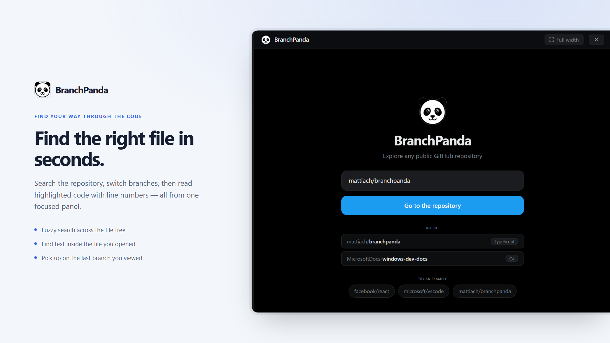
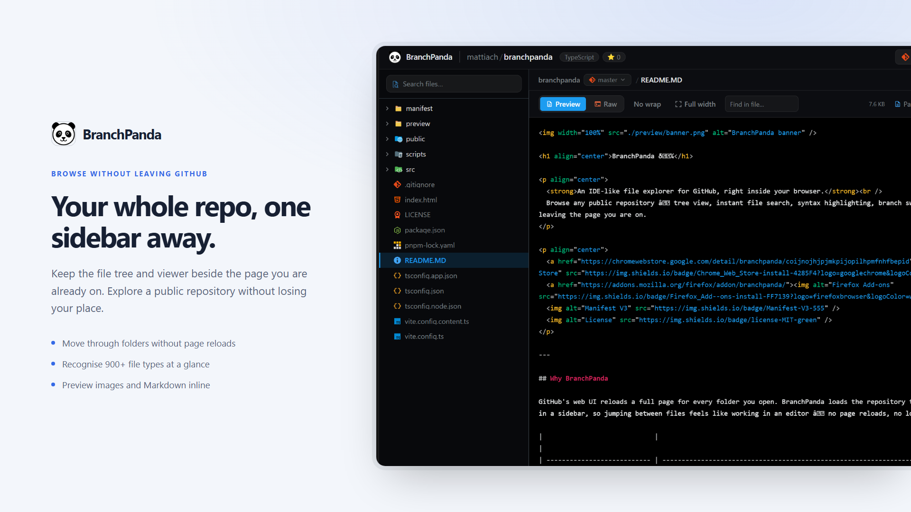

<h1 align="center">BranchPanda 🐼</h1>

<p align="center">
  <strong>An IDE-like file explorer for GitHub, right inside your browser.</strong><br />
  Browse public repositories with a file tree, instant search, syntax highlighting, and branch switching — without leaving GitHub.
</p>

<p align="center">
  <a href="https://chromewebstore.google.com/detail/branchpanda/coijnojhjpjmkpijopilhpmfnhfbepid"></a>
  <a href="https://addons.mozilla.org/firefox/addon/branchpanda/"></a>
  
  
</p>

## Preview

<p align="center">
  
  <sub>Open a repository, revisit recent projects, or try an example.</sub>
</p>

<p align="center">
  
  <sub>Browse files and explore the repository tree without leaving GitHub.</sub>
</p>

## Why BranchPanda?

GitHub's web UI requires navigating between pages to explore files. BranchPanda keeps the repository tree and file viewer in a sidebar, making it easier to navigate between files without losing your place.

| Feature                             | Description                                                                                    |
| ----------------------------------- | ---------------------------------------------------------------------------------------------- |
| 🗂️ **Tree explorer**                | Lazy-loaded, cached repository tree with 900+ file-type icons                                  |
| 🔎 **Fuzzy file search**            | Find files by name or path across the repository                                               |
| 🎨 **Syntax highlighting**          | Prism-powered highlighting, line numbers, line wrapping, and Markdown preview                  |
| 🔤 **In-file search**               | Search within files using <kbd>Ctrl</kbd>/<kbd>Cmd</kbd> + <kbd>F</kbd>, with match navigation |
| 🌿 **Branch switcher**              | Switch branches from the breadcrumbs; the last branch is remembered per repository             |
| 🖼️ **Image preview**                | View images directly in the file viewer                                                        |
| ↔️ **Resizable sidebar**            | Resize or expand the panel; its size is remembered                                             |
| 🕘 **Recent repositories**          | Reopen recently visited repositories from the home screen                                      |
| 📋 **Quick actions**                | Copy file paths and URLs, download files, or copy the `git clone` command                      |
| ⚡ **No account or token required** | Access public repositories through the GitHub API without signing in                           |

## Installation

Install BranchPanda directly from your browser's extension store.

| Browser                                                                             | Store                                                                                                     |
| ----------------------------------------------------------------------------------- | --------------------------------------------------------------------------------------------------------- |
| **Chrome, Brave, Edge, Opera, Vivaldi, Thorium**, and other Chromium-based browsers | [Chrome Web Store](https://chromewebstore.google.com/detail/branchpanda/coijnojhjpjmkpijopilhpmfnhfbepid) |
| **Firefox**                                                                         | [Firefox Add-ons](https://addons.mozilla.org/firefox/addon/branchpanda/)                                  |

## Usage

On a public GitHub repository page, BranchPanda adds a button to the repository header. Click it to open the explorer panel, with the file tree on the left and the file viewer on the right.

You can:

- Browse folders and files through the repository tree.
- Search for files by name or search within the currently open file.
- Switch branches and restore the last selected branch for each repository.
- Preview images and rendered Markdown.
- Navigate folders using clickable breadcrumbs.
- Open recent repositories or enter an `owner/repo` pair to explore another repository.

BranchPanda also works as a standalone popup from the browser toolbar, allowing you to explore repositories from any tab.

## Privacy and security

### Public repositories only

BranchPanda supports public repositories and does not request authentication or store access tokens. It uses the public GitHub API without requiring additional browser permissions.

### Local storage

BranchPanda stores its data in your browser's `localStorage`, using the `branchpanda_` prefix. This includes:

- Cached API responses, with a 5-minute TTL.
- UI preferences and sidebar settings.
- The last selected branch for each repository.
- Recently opened repositories.

Repository data is retrieved from `api.github.com` and `raw.githubusercontent.com`. BranchPanda does not send this data to other services.

## Tech stack

| Component           | Technology                                   |
| ------------------- | -------------------------------------------- |
| UI                  | [Preact](https://preactjs.com/) + TypeScript |
| Styling             | [Tailwind CSS v4](https://tailwindcss.com/)  |
| Animation           | [Motion](https://motion.dev/)                |
| Syntax highlighting | [Prism.js](https://prismjs.com/)             |
| Build tool          | [Vite](https://vite.dev/)                    |
| Platform            | Manifest V3, Chrome and Firefox              |

Vite produces separate builds for the popup app and the content script.

## Development

### Prerequisites

Install [Node.js](https://nodejs.org/) and [pnpm](https://pnpm.io/installation), then install the dependencies:

```bash
pnpm install
```

### Available scripts

| Script                   | Description                                                            |
| ------------------------ | ---------------------------------------------------------------------- |
| `pnpm dev`               | Runs the panel as a standalone web app using Vite's development server |
| `pnpm build:chrome`      | Type-checks and builds the Chrome extension into `dist/`               |
| `pnpm build:firefox`     | Type-checks and builds the Firefox extension into `dist/`              |
| `pnpm version:manifests` | Synchronizes both manifest versions with `package.json`                |

The extension code is shared between browsers; only the manifest differs.

### Load the unpacked extension

- **Chrome, Edge, Brave, and other Chromium browsers:** Open `chrome://extensions`, enable **Developer mode**, click **Load unpacked**, and select `dist/`.
- **Firefox:** Open `about:debugging` → **This Firefox** → **Load Temporary Add-on**, and select `dist/manifest.json`.

For regular use, install the published extension from the [Chrome Web Store](https://chromewebstore.google.com/detail/branchpanda/coijnojhjpjmkpijopilhpmfnhfbepid) or [Firefox Add-ons](https://addons.mozilla.org/firefox/addon/branchpanda/).

## Contributing

Issues and pull requests are welcome. Keep changes focused, run `pnpm build:chrome` before opening a pull request, and specify which browser you tested.

## Author

**mattiach** — [GitHub](https://github.com/mattiach) · [LinkedIn](https://www.linkedin.com/in/mattiach/)

## License

MIT — see [LICENSE](./LICENSE).
